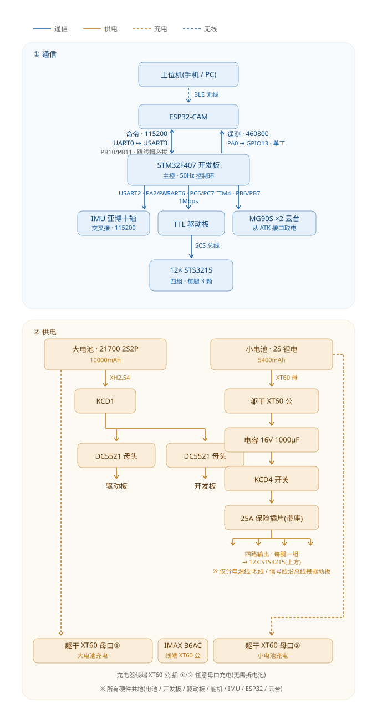

# cat3.3 接线说明



> ✅ **定稿(2026-09-28)**。上图为**直观总览**(图片);下方为**可编辑树图** ——
> 改接线**直接改树图文字**即可,图随后同步重生成;二者如有出入,以树图为准。
> ⚠️ **通用要求:所有硬件共地**(电池 / 开发板 / 驱动板 / 舵机 / IMU / ESP32 / 云台)。
> 物料见 [cad/BOM_复刻物料清单.md](../cad/BOM_复刻物料清单.md)。

---

## 一、供电电路

### 1.1 双电池

| 电池  | 供电对象            | 容量                  |
| --- | --------------- | ------------------- |
| 大电池 | 开发板 + 驱动板       | 21700 2S2P 10000mAh |
| 小电池 | 舵机(12× STS3215) | 2S 5400mAh          |

### 1.2 大电池链(供 开发板 + 驱动板)

```
大电池(21700 2S2P 10000mAh)
 ├── 充电 ──> 躯干 XT60 母口①(对接充电器)
 └── 放电 ──(供电口: XH2.54)──> KCD1 小开关 ──┬── DC5521 母头 ──> 驱动板
                                            └── DC5521 母头 ──> 开发板
```

### 1.3 小电池链(供 舵机)

```
小电池(2S 5400mAh)
 ├── 充电 ──> 躯干 XT60 母口②(对接充电器)
 └── 放电 ──(供电口: XT60 母头)──> 躯干 XT60 公头(对插)
            ──> 并联电容(16V 1000µF)──> KCD4 开关 ──> 25A 保险插片(带座)
            ──> 分四路 ──> 四组舵机(每腿一组,3 颗/组)
                  ※ 四路仅分【电源线】;地线、信号线沿用串行总线接法接到驱动板
```

### 1.4 充电

```
IMAX B6AC(线端: XT60 公头)
 └── 插 躯干母口① / ② 任意一个充电(无需拆电池)
```

---

## 二、通信电路

### 2.1 总链路

```
上位机(手机 / PC)
 └── BLE 无线 ──> ESP32-CAM(BLE 桥)
      ├── 命令 ──> STM32(USART3: PB10/PB11 @115200,交叉接)
      │   
      └── 遥测 ── STM32(UART4: PA0 @460800)──> ESP32(GPIO13)  ※单工,一根线
```

### 2.2 STM32 外设

```
STM32F407 开发板
 ├── USART2(PA2 / PA3 @115200,交叉接)──> IMU 亚博十轴(P9 座)
 │        ⚠️ 电平随模块供电,接错烧 PA2/PA3;启动 5000ms 后才出数据
 ├── USART6(PC6 / PC7 @1Mbps)──> TTL 驱动板 ──> 12× STS3215
 │        ⚠️ 经驱动板不可短接 PC6/PC7;使用期间不插板载 OLED / CAMERA
 └── TIM4(PB6 = pan / PB7 = tilt,50Hz PWM)──> MG90S ×2 云台
          └ 供电:从板载 ATK 接口处取电
```

### 2.3 ESP32-CAM 烧录(维护时)

```
USB-TTL ──> ESP32-CAM
 5V / GND ── 5V / GND(供电必须稳)
 TX ── GPIO3(U0R)    RX ── GPIO1(U0T)
 GND ── GPIO0(下载模式,烧完必须断开)
 ※ 烧录时不接 STM32(抢同一对线);烧完拔 USB-TTL 再按"运行时"接回
```

---

## 三、接头与线材(采购)

> 已排除**充电器自带**(XT60 公头)与**两块电池自带**的接头;以下为需另购。

| # | 接头 / 线材 | 数量 | 用途 |
|---|---|---|---|
| 1 | XT60 公头 | 1 | 躯干供电入口(对插小电池) |
| 2 | XT60 母头 | 2 | 躯干充电口 ×2(配充电器 XT60 公) |
| 3 | XH2.54 对插(配电池侧另一半) | 1 套 | 大电池供电口 |
| 4 | DC5521 母头 | 2 | 分给驱动板 / 开发板供电 |
| 5 | XH2.54 ↔ SM2.54 转接线 | 公转母 ×5、母转公 ×5 | |
| 6 | 串行总线舵机连接线(母对母) | 4 根 | |
| 7 | XH2.54-3P 公母延长线 | 10 条 | |
| 8 | 杜邦线(各类) | 大量 | 通信接线用 |

**免焊建议**:
- 买接头时**优先选"带线免焊"款**(成品线 / 压接式);
- **没有焊接经验的,尽量寻求免焊方案**。
